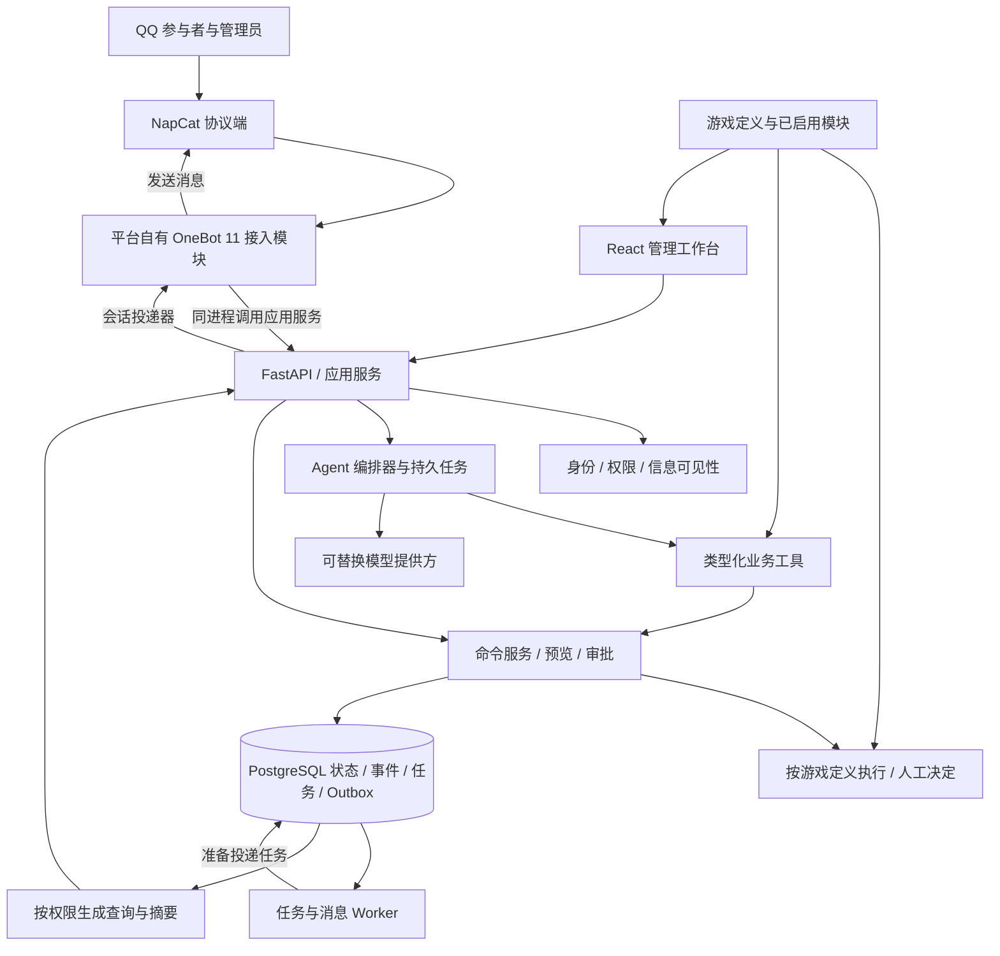
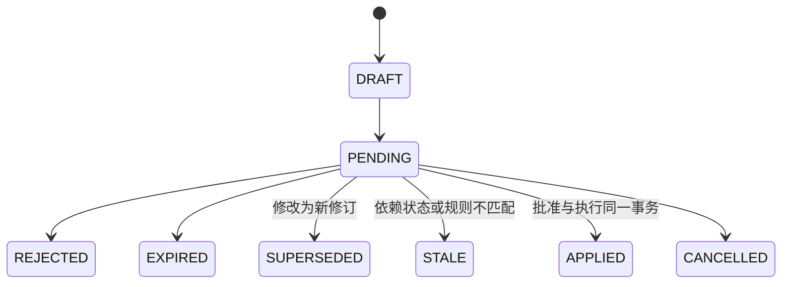

# MythWeaver 技术设计

版本：v0.7 · 日期：2026-10-29 · 状态：设计基线，部分已实施；当前实现见 [运行说明](04-running-local.md) 与 [首版验收跟踪](07-acceptance-status.md)。

关联：[需求](01-product-requirements.md) · [QQ 接入决策与来源](03-qq-integration-decision.md)。

## 1. 主要决策

1. 采用模块化单体，自有 OneBot 11 接入模块首版挂载在 API 进程，后台任务独立运行，共用领域代码及 PostgreSQL。
2. 游戏核心不依赖聊天框架和模型；所有写入统一走命令服务。
3. 首版一个 Agent 编排器，使用不同权限的任务上下文和工具集，不引入多 Agent。
4. 管理员定义游戏概念、数据与操作；有自动化规则时执行规则，无规则时允许手工主持。AI 按当前定义辅助，不自行补全游戏机制。
5. 管理员可覆盖全部游戏规则，但操作仍满足结构校验、事务和权限校验。
6. 当前状态、业务事件、操作审计和消息投递分开建模，并在事务边界内衔接。
7. QQ 协议端可替换；Web、CLI/运维和 QQ 调用相同业务接口。
8. 首版 NapCat 通过反向 WebSocket 直连平台，不引入 NoneBot2、Koishi 或 AstrBot 等中间机器人框架。
9. 高灵活性通过 Agent 动态创建模块、函数、交互和流程，配合决定策略和人工接管实现；不把玩法顺序写死，也不提前引入通用流程引擎。
10. 核心不依赖角色、战斗、背包、骰子、剧情或阶段。空白游戏可运行；具体玩法是管理员配置或选择的模块，不是通用内核的必备对象。

## 2. 架构与技术栈



| 部分 | 建议 | 取舍 |
| --- | --- | --- |
| QQ 接入 | 平台自有 OneBot 11 模块 + FastAPI WebSocket 入口 | NapCat 直接连接；平台实现会话、消息解析、指令、身份映射和 API 回包关联，不容纳游戏领域逻辑 |
| 核心 | Python 3.12 起步，FastAPI、Pydantic、SQLAlchemy、Alembic | 统一类型和异步生态；具体版本实施时兼容验证并锁定 |
| 数据 | PostgreSQL，关系字段 + JSONB 扩展 | 并发事务、查询和自定义字段并重 |
| Agent | 自建轻量工具调用循环 + 持久任务状态 | 服务商 SDK 藏在 Provider 接口后，不绑定单一模型平台 |
| 前端 | React + TypeScript + Vite | 按当前游戏定义生成界面、管理表格、差异预览与任务监控，不固定 RPG 导航 |
| 后台任务 | PostgreSQL 持久任务表 + 独立 Python Worker | 首版减少组件；需要扩展时再评估 Redis/专用队列 |
| 文件 | 本地数据卷，后续可换兼容对象存储 | 附件、规则包、导出与备份清单 |
| 部署 | 当前采用 Windows 原生 Python/Node/PostgreSQL，不使用 Docker | 沿用用户的本机 NapCat；未来需要服务器部署时另行选择，不作为当前前提 |

不使用 SQLite 作为并发验收的替代后端；本地开发也优先使用 PostgreSQL。向量库不列为首版必需，先使用结构化检索和数据库文本检索。

建议代码结构：

```text
apps/api/                  HTTP、Web 登录、OneBot 反向 WS 入口
apps/worker/               Agent 任务、摘要、消息投递
apps/web/                  管理工作台
mythweaver/domain/         实体、命令、规则、权限接口
mythweaver/definitions/    对象/字段/操作定义、版本、校验与迁移
mythweaver/modules/        可选能力的声明与注册，不默认启用玩法模块
mythweaver/application/    用例、审批、预览、事务协调
mythweaver/agent/          编排、上下文、工具注册、模型适配
mythweaver/infrastructure/ 数据库、文件、消息、扩展执行
mythweaver/infrastructure/channels/onebot11/
                           自有会话管理、协议转换、API 回包关联
examples/                  管理员选定的示例配置，无固定玩法要求
tests/                     领域、并发、权限、接入契约
docs/                      当前文档
```

上述为目标目录建议；当前代码结构采用较紧凑的模块化单体，尚未拆出独立 Worker。

## 3. 业务边界与身份

- GameDefinition 保存管理员的游戏定义；Campaign 是实际运行的游戏实例，沿用该内部命名不表示必须是跑团；Branch 保存当前历史分支。模板可选，空白定义合法。
- 所有团内对象必须带 campaign_id；分支化运行对象还带 branch_id。
- 首版每个团只有一个活动分支，历史分支可读；恢复通过复制检查点和后续事件建立新分支。
- 定义、模板或模块新版本不会静默覆盖现有实例；由管理员指定生效范围并处理不兼容变更。
- Principal 表示平台用户；ExternalIdentity 绑定协议端及外部账号；Membership 表示团角色。
- QQ 群号、QQ 号及官方 API 的不透明用户/群标识都按字符串存储，不能假设它们能直接互换。
- QQ 绑定 Web 账号使用一次性、短时、单次消费的绑定码；平台所有者由部署时的一次性引导流程建立，不以“第一个发消息的人”为管理员。
- Web 使用服务端会话、HttpOnly Cookie 和 CSRF 防护；OneBot 连接使用独立 Token 并校验允许接入的 bot_id。连接认证与 QQ 消息操作者身份分别处理，Token 本身不授予玩家或游戏管理权限。接入模块从事件中的原始外部标识映射实际操作者，再调用应用服务。

授权按 actor、operation、resource、campaign、branch、字段可见性执行。界面隐藏和提示词都不能代替服务端校验。Agent 请求的 actor_id、scope、role 不接受模型自由赋值，而是由服务端上下文注入。

平台用户不等于游戏内人物；是否有任何人物对象、参与者能操控哪些对象均由定义决定。主持人/玩家是可修改的权限模板。已启用模块也是操作授权的必要条件，不能绕过停用状态直接调用旧工具或 API。

## 4. 核心数据模型

以下为逻辑表设计，字段不是完整 DDL。id 统一使用 UUID，时间保存 UTC，界面按 Asia/Hong_Kong 显示。

| 表 | 关键字段与用途 |
| --- | --- |
| principals / external_identities | 平台身份、外部平台/应用/账号、绑定状态；外部三元组唯一 |
| campaigns / memberships / channel_bindings | 团、角色授权、QQ 群绑定；一个渠道一个活动绑定 |
| game_definitions / definition_revisions | 可为空白的游戏定义、对象/字段/操作 schema、约束、可见性、版本及迁移 |
| entity_types / entity_records / entity_relations | 管理员自定义类型、实例字段值、引用和版本；不预设人物或物品 |
| content_records | 自由文本和结构化资料、可见范围、修订；剧情事实只是其中一种可选用途 |
| module_versions / module_bindings | 模块声明、能力/界面/工具/权限/依赖、实例启用状态及配置 |
| interaction_definitions / rule_definitions | 可选交互、输入 schema、允许者、条件和结果操作 |
| decision_policies / trigger_definitions | 可选的决定方式、触发条件及作用范围，不强制有阶段或场景 |
| event_occurrences | 启用触发时的实例、定义版本、来源及已提交结果；同次触发唯一 |
| branches / checkpoints | 活动分支、父分支、分叉事件、状态快照、规则和扩展引用 |
| rule_packages / rule_releases | 可选规则集合、表达式/操作、哈希、版本与依赖，不规定职业/装备等字段 |
| commands / command_batches | actor、幂等键、输入、状态、规则版本、执行结果 |
| proposals / proposal_revisions | 团/分支、意图、kind（行动建议/剧情待决定）、计划或待填结果、read_set、规则/推进配置版本、截止时间、状态 |
| approval_decisions | 提议修订号、批准/拒绝人、理由、执行命令；修订决策竞争受约束 |
| events | 每分支递增 seq、业务类型、版本、actor、batch、定义/规则引用、状态差异、可见性；模块附加元数据可选 |
| audit_entries | 配置/授权/读取秘密等管理操作、原因、敏感内容脱敏 |
| inbox | 渠道事件键、收到时间、原始载荷引用、处理状态、重试信息 |
| outbox / deliveries | 事件引用、受众、消息内容/模板、投递状态、重试及外部回执 |
| agent_tasks / tool_invocations | 任务、状态、授权快照、实时授权检查、预算、工具调用与结果 |
| summaries | 源事件范围、受众、模型/提示词版本、生成状态、过期标记 |
| platform_settings / tool_policies | 配置版本、工具策略、密钥引用，不存明文到事件 |
| jobs / extension_versions | 持久任务、租约、扩展版本、签名/哈希、运行权限 |

内核约束仅包括身份、数据类型、实例/分支边界、有效引用、版本和事务完整性。库存非负、装备槽互斥、生命上限等属于选用模块或管理员自定义约束，不写入通用内核。管理员可修改业务约束及其数据迁移策略。

首版自定义字段支持文本、数值、布尔、枚举、列表、对象引用及结构化扩展。字段 schema 独立版本化，数据保存所用版本；增字段、改名、兼容类型调整走定义服务，不要求新建数据库表或编写业务代码。不兼容迁移在预览中报告实例与引用影响。查询、表单、导出与权限都使用同一 schema；不能仅让数据库保存未知 JSON 而界面和 Agent 无法管理。

角色、物品、战斗等将来如被选用，可由模块注册类型/操作，并按性能需要增加模块自有表；不列为首版核心表或默认创建数据。

JSONB 中只放 schema 校验后的自定义数据。通用编辑器仅接受实体允许的业务路径；主键、团归属、事件序号、平台角色等不通过任意 JSON patch 更改，须调用对应管理命令。

## 5. 命令执行、事务和并发

首版按团的活动分支串行提交写事务，复杂计算在锁外进行；该策略适合约 6 人场景。读取和模型调用不持有写锁。

处理流程：

1. 自有 OneBot 接入模块把 NapCat 事件转换为标准 Envelope，先写 inbox；唯一键防止重复受理。
2. 查询和当前游戏已启用的明确操作走确定性路由；自然语言由 Agent 查询定义后解析为类型化 Command 或可选 Proposal。未启用或未定义操作不能靠模型猜测执行。
3. 服务端绑定实际 actor、campaign、branch、幂等键，检查权限和目标范围。
4. 查询所需状态形成 read_set（对象 ID + version + 定义/模块/规则版本），检查适用的决定策略；仅配置为需要人工决定时建立待决定事项，否则生成计划及影响预览。未配置阶段时不检查不存在的阶段。
5. 执行时开启数据库事务，锁活动分支协调行并复核其身份，按固定顺序锁目标对象，重新检查 read_set 与权限。
6. 在事务内执行已验证的有界状态操作，更新状态/version，追加 events、audit、outbox、command result。模块有额外计算时按其声明执行。
7. 一次提交。Worker 在事务之外准备通知、更新摘要，API 进程的会话投递器发送通知；失败只重试任务，不重新执行游戏命令。

幂等命令通过数据库唯一键约束；并发重复请求读取既有结果。批量命令首版限定目标数量与载荷大小，在单一事务内全成或全败。超过限制的请求生成分批计划，管理员可以选择分批执行，并明确不提供跨批原子性。

QQ 入站键建议 `(adapter, bot_id, conversation_id, event_type, message_id)`，实际依协议确定；缺少可靠 ID 的事件通过适配器契约处理，不能只用文本哈希永久去重，避免把相同的两次合法行动合并。

如果以后选用随机模块，随机结果由程序生成并持久化，命令重试/重放返回已提交结果而不再次抽样。随机模块及骰子不是内核必需能力。

乐观版本冲突：无副作用查询可重新读取；涉及花费、审批、规则发布的冲突返回 `STATE_STALE`，重新生成计划；不静默按新状态花费不同资源。

## 6. 审批状态机

本节只在管理员为某项交互配置了人工决定/审批时适用。游戏可以没有任何待审批操作，不创建提议也能运行。



每次修改生成不可变 revision。批准请求必须引用 proposal_id、revision 和 plan_hash；QQ 简短编号由服务器解析到当前具体修订，修改后的提议重新通知，不沿用旧审批。

执行批准时检查 actor 仍有 GM/管理员权限、提议属于当前团/分支、未过期、状态 PENDING、read_set 完整匹配。批准记录、游戏变更和 APPLIED 状态同一事务提交。若内部错误事务回滚，保留待审批状态并记录失败尝试，不形成“已批准但未执行”的半成品。

“到期”以数据库时间校验，不依赖清理任务及时运行。权限撤销或分支切换后旧提议不能执行。对已拒绝、过期、过时的方案，只能创建新修订再裁决。

剧情待决定事项复用该审批与任务机制，但可暂时没有最终结果，例如“内鬼身份待管理员指定”。缺少结果的事项不能直接批准执行；管理员选择或填写结果后生成完整计划，再按同样的版本校验和事务路径提交。允许管理员明确指定结果并在同一请求内完成修订与执行，无需人为增加两次确认。

## 7. 游戏定义、可选规则与扩展

GameDefinition 是管理员定义内容的版本集合，可包含 entity_types、fields、interactions、constraints、decision_policies、visibility、enabled_modules，以及可选的 triggers/arrangements。各玩法部分允许为空；空白实例只依靠参与者、文字记录和管理员操作即可运行。

通用操作原语优先覆盖创建/修改/归档对象、增减数值、修改列表/关系、记录参与者输入、追加内容、建立待决定事项、发布获准消息以及简单条件判断。不把伤害、恢复、冷却、回合、奖励等专用概念放进必需原语。

下面仅展示管理员自定义交互的表达方式，不规定游戏必须有线索或该操作。普通用户通过表单/Agent 编辑，无需手写 YAML；格式尚未实现。

```yaml
id: reveal_note
input:
  record: {type: reference, entity_type: note}
allowed_actor: manager
result:
  - operation: set_field
    target: input.record
    field: visibility
    value: public
```

操作是否允许公开某字段须通过实际权限检查，声明本身不能替代授权。定义可不含自动结果，而由管理员现场决定。选择 fixed/rule/player_choice/gm_decides/ai_proposes_gm_decides 等方式时，只改变相应事项；这些是基础策略而非固定游戏类型列表。

规则表达式使用白名单 AST，不使用 Python eval，限制运算量、深度和可读字段。程序结果包含适用定义、输入、条件、状态差异与事件，AI 可以解释但不能私改结果。没有可执行规则的机制可以保持手工处理，并不意味着游戏无法运行。

定义发布/修改：检查 schema、权限和引用 → 对已有数据预检 → 确定生效范围与迁移 → 提交新版本。允许定义不完整的草稿；不完整自动操作不能启用，但其他合法操作和手工主持继续。修改不兼容字段或停用模块时检查依赖，不强迫管理员填满一套预设玩法。

### 7.1 可选模块的边界

模块声明版本、提供的类型/字段/操作、界面和 Agent 工具、依赖、权限、配置 schema、升级/停用处理。首版先实现声明式能力注册；新执行代码通过部署端可信扩展安装。模块能力只在该游戏启用并获授权时出现，通用 API 执行时也必须复核启用状态。

启用前展示变化；停用时阻止新调用、处理相关未执行任务，保留历史与可恢复数据。有依赖的其他操作须迁移或显式停用，不能静默删除。模块升级固定版本，已提交事件保留原版本引用。

战斗、骰子、背包、人物、投票、剧情、分析都只是可能的能力包，不预设它们已实现或首版必做。无模块的实例也可以创建自定义对象和交互。核心通用命令、权限、记录和恢复不能依赖任何具体玩法模块。

### 7.2 可选的推进安排

如管理员需要自动推进，可定义简单触发、结果决定方式、可见范围和局部阻塞范围；不需要时不创建阶段、场景或流程图。触发可从手工或已提交操作/状态条件开始；实际回合、投票轮次等时钟由选用模块定义，内核不假设存在回合。

同一事项的精确策略优先于适用范围默认策略，同级冲突在校验时报告。持久任务按定义版本与来源事件/命令去重，限制单次因果链的触发次数，避免无回合游戏出现无限循环。管理员可预设结果，也可留待人工指定。

等待只作用于已声明范围。未提交的状态变更不提前执行；若前序操作已独立提交，保留该事实，后续另建待决定事项。已提交结果不会因新定义发布自动重演。

运行中可新增/修改/停用定义，立即生效或只用于后续；只有使用阶段的游戏才提供“下阶段生效”。旧预览、后台任务和待决定事项执行前复核定义/模块版本，过时则重新评估或取消。管理员可临时手工接管，之后是否恢复自动处理由其决定。

### 7.3 新机制与扩展

字段、对象、普通状态操作和条件组合通过界面/Agent 配置；真正新增算法、外部能力或无法由现有原语表达的机制通过版本化扩展增加。不能以“只支持既有战斗属性”限制自定义数据，也不能承诺配置能自动实现任意程序。

不自动执行群消息/模型生成的代码。需要自定义代码时，由管理员安装有声明权限的可信扩展；独立进程/容器运行器就绪后再提供受限执行。扩展仅返回结构化操作，最终写入仍走同一命令服务；没有隔离运行器时不开放在线代码执行。

## 8. Agent 能力和权限模型

Agent 根据当前游戏定义提供意图理解、内容/数据管理和获授权执行；每个任务创建独立上下文，工具取“平台已实现能力 ∩ 当前实例已启用能力 ∩ 操作者权限 ∩ 任务授权”。管理员创建的新对象与操作通过通用工具立即可管理，不需要为每种对象写专用 Agent。

| 工具组 | 示例 | 默认执行策略 |
| --- | --- | --- |
| 定义与模块 | definition.get、definition.preview_change、definition.apply_change、module.configure | 管理员/获授权管理者可修改；按定义版本检查 |
| 读取 | entity.query、content.get、definition.inspect、events.search | 按当前定义与操作者可见范围 |
| 参与者交互 | interaction.submit、action.preview、action.execute | 仅限已定义/启用并获授权的交互，不预设骰子或战斗 |
| 裁决 | proposal.create、proposal.revise、proposal.decide | 玩家仅能创建建议；GM 可决定 |
| 内容 | content.draft、content.edit、summary.generate | 具体用途由管理员指定；生成内容不是自动发生的游戏事实 |
| 管理 | entity.create、entity.preview_patch、entity.apply_patch、entity.archive、batch.execute | 按对象 schema 和权限执行；不以角色/物品为固定类型 |
| 可选决定与推进 | decision.resolve、trigger.configure、trigger.invoke | 只在配置需要时使用，不强制设场景、阶段或剧情 |
| 规则 | rules.validate、rules.simulate、rules.publish、rules.migrate | 发布/迁移检查授权与影响范围 |
| 恢复 | history.inspect、history.compensate、checkpoint.create、branch.restore | 涉及整团时提示具体范围 |
| 平台 | access.grant、agent.configure、extension.register、backup.restore | 平台管理员专属，敏感操作审计 |

通用管理工具接受 schema 限定的业务变更。无法表达的新对象先增加 schema/扩展，不开放任意 SQL 作为 Agent 日常工具。

模型上下文先包含当前有效的定义与能力清单。未启用的模块不加载提示、工具或导航；用户提到一个未配置概念时，按上下文作为文字内容、请求管理员定义或使用其指定的手工处理策略，不能自行创建生命值、物品、奖励或主线。模块停用后即时使工具权限和相关缓存失效。

一次任务循环：接收意图 → 查询最小必要资料 → 消除歧义 → 生成类型化计划 → 服务端预检 → 根据既有授权执行或进入裁决 → 读取真实执行结果 → 返回说明。设置最大步骤、工具次数、上下文长度、执行时间、并发任务和费用预算。

管理员任务可直达写工具，不必先创建 GM 提议；既有明确命令即可执行。批量目标不明时先澄清；管理员可配置“本团数值修订自动执行，规则迁移先预览”等策略，默认策略透明可见。

只给模型当前任务需要的字段；GM 私有上下文与玩家上下文分开。NPC/导入文档/群消息属于资料，里面的“授予管理员权限”等文字不转化为系统授权。即使模型错误调用平台管理工具，服务端仍按真实 actor 拒绝。

管理授权可设 scope、tool_allowlist、target_filter、expires_at、max_batch_size；每次工具执行重新检查即时权限。发布全局策略、授予权限或恢复备份不允许通过普通玩家自动执行授权间接获得。

写操作的执行回执来自真实提交结果，模型不能先宣布状态已改变。管理员若启用自由对话/内容生成，文字回复可以独立生成，不要求先有游戏状态变化；是否调用模型、何时触发、是否写入事实由当前定义和授权决定。未启用的扮演或叙事能力不默认运行。

任务持久状态包括 QUEUED、RUNNING、WAITING_GM、SUCCEEDED、FAILED、CANCELLED。Worker 通过数据库租约领取；任务重启后读取已完成的工具调用，不重做已提交副作用。每个工具调用派生唯一 command key。取消只阻止后续步骤，已提交结果通过新命令补偿。

模型故障降级：停止生成建议，通用查询、已有确定性操作及手工管理继续；语义不明确时提示显式操作，不能因备用模型重试而重复提交游戏变更。

## 9. 内容、记忆和信息可见性

真实性以当前定义、实例状态和显式修订为准；事件表示当时已提交的内容，摘要/生成草稿不覆盖数据库。文档、人物故事或剧情安排仅在当前游戏使用它们时存在。发现状态、记录与管理员资料冲突时返回来源与修订关系，不让模型猜测哪个已经发生。

检索先按 actor/受众过滤，再提供给模型；不把秘密先放进上下文再要求模型保密。内容工具区分草稿/安排与已确认状态。资料包含修订来源、visibility 和 supersedes，需要时间线的游戏再配置有效时间字段。

摘要按团/分支/受众和事件范围生成。公开摘要只能使用公开事件，个人摘要只能使用本人可见事件。状态纠正、可见性变化或分支切换时使有关摘要及检索缓存失效。对外消息在出站时再次检查受众，避免排队期间权限变更泄密。

管理员可以读取秘密，不意味着其管理 Agent 的每条 QQ 公开回复都可包含秘密；工具结果显式标记 sensitivity，公开输出由服务端限制。

## 10. 历史、撤销与恢复

采用“当前状态 + 追加领域事件 + 快照”，首版不实施跨服务完整事件溯源。事件存储足够重放的已解析状态差异、schema/定义/模块版本和必要输入结果；不靠旧版本模型重新推导历史。

- 无依赖撤销：核对目标对象版本，通过新补偿命令恢复，保留原事件。
- 有依赖撤销：展示后续依赖，不直接写回旧对象快照；GM 选择补偿方案或整个团恢复分支。
- 团恢复：短暂停止该团新提交 → 读取检查点和后续事件 → 建立新分支 → 校验快照 → 切换活动分支 → 旧提议和未执行任务取消/过时化。
- 旧分支中已提交 QQ 通知不撤销业务事实；待发送消息按分支状态取消，已经投递的通过更正说明。
- 规则/扩展版本、定义版本和快照在引用有效时保留；清理前显示会失去的重放范围。
- 备份包括数据库、附件、规则/扩展清单和配置版本；密钥通过独立安全渠道备份。恢复需验证文件哈希、引用完整性、活动分支及版本一致性。

管理员可执行维护清理，但在线审计界面不提供悄悄重写旧事件的功能。清理改变保留策略和恢复窗口，不能承诺抵抗拥有数据库/主机控制权的管理员篡改。

## 11. QQ 传输与可靠性

标准 Envelope：adapter、application_id、bot_id、conversation_id、message_id、external_actor_id、received_at、message_segments、reply_to、visibility_context。所有 ID 为字符串。

NapCat 作为反向 WebSocket 客户端，直接连接平台 FastAPI 提供的 `/channels/onebot/v11/ws`，同一 Universal 连接用于事件上报与 API 调用。平台是 WebSocket 服务端；NapCat 负责断线后的连接重试，平台负责会话注册、过期清理和在途请求处理。路径为本项目约定，不依赖任何外部机器人框架的默认挂载路径。同机仅监听回环或容器私网，跨机使用加密连接和受限网络访问。WebUI 管理凭据与 OneBot Token 分开管理。

自有接入模块负责消息段解析、@、回复引用、显式命令路由和发送结果转换。NapCat 配置优先使用 array 消息段；业务数据库不存 CQ 字符串作为核心语义；发送前通过适配器转换为消息段，避免玩家文本被误解为控制段。自然语言意图交给 Agent，接入模块不包含规则结算或权限决策。

接入模块的必要职责：

- 在握手阶段检查 Token 和接入账号白名单，处理生命周期、心跳与当前账号身份；事件 self_id 必须与已认证会话账号一致。
- 区分事件帧与 API 响应帧；发送请求时生成唯一 echo，并按 echo 关联响应，校验 status/retcode，支持并发及乱序回包。
- 同一 bot_id 首版只保留一个有效会话；替换连接时递增会话代次，旧连接关闭不得误删新会话，旧回包不得完成新请求。
- API 进程持有连接；Worker 只领取和准备投递任务，实际发送由持有会话的 API 投递器完成，投递状态写数据库。首版 API 固定单进程，避免多 Worker 各自只看到部分连接；后续独立网关或多实例部署需先实现会话路由。
- 对连接断开时未完成的发送标记不确定状态；不跨重连自动重放可能已经执行的 API 调用。只读 API 可按策略重新查询。
- 入站事件持久化到 inbox 后再交业务任务处理；采用有界队列、消息长度限制和单账号发送限速，异常帧隔离记录，不能阻塞其他会话。
- 平台重启会丢失内存中的未受理帧与在途请求；仅已提交 inbox 的消息享有恢复处理保证。

Outbox 提供可重试投递，不能保证 QQ 端恰好一次显示：发送成功但回执丢失时可能重复。使用批次/行动编号帮助识别重复；不明确成功状态进入 UNKNOWN 并按策略核查/人工重发，不无限盲目重试。无论通知如何重复，游戏命令只提交一次。

重连不等于补齐离线群消息；不假设协议端必然重放。inbox 只保证已受理消息可恢复处理，离线期间遗漏的行动由玩家重发或 GM 对账。

Adapter 声明 capability：群收发、@事件、私聊、引用、文件、主动通知、交互组件、历史补拉。不支持的功能显式降级；GM 审批不能把不可用的私聊当唯一出口。

## 12. API 草案

| 方法与路径 | 用途 |
| --- | --- |
| WS /channels/onebot/v11/ws | NapCat 反向 WS 直连入口，连接鉴权、事件接收及 echo 关联 API 回包；不属于 Web 用户会话 API |
| GET /v1/campaigns/{id}/state | 按权限查询团状态 |
| GET /v1/campaigns/{id}/definition | 获取当前定义、可用对象/操作、模块与界面配置 |
| POST /v1/campaigns/{id}/definition-changes | 预检并应用版本化定义变更，含引用检查和迁移方案 |
| GET/POST /v1/campaigns/{id}/entities | 按自定义类型查询/创建对象，不要求是人物或物品 |
| POST /v1/campaigns/{id}/interactions | 接受定义中的交互输入，按授权和当前策略处理 |
| PATCH /v1/campaigns/{id}/modules/{module_id} | 配置、启用或停用已实现模块，校验依赖和任务影响 |
| POST /v1/campaigns/{id}/commands/preview | 返回目标、差异、read_set、plan_hash 与过期时间 |
| POST /v1/campaigns/{id}/commands | 提交明确命令，可带已预览计划引用 |
| POST /v1/campaigns/{id}/proposals | 创建特殊裁决提议 |
| POST /v1/proposals/{id}/revisions | 修改提议 |
| POST /v1/proposals/{id}/decisions | 批准/拒绝具体 revision，原子执行 |
| POST /v1/campaigns/{id}/agent-tasks | 启动获授权 Agent 任务 |
| GET /v1/agent-tasks/{id} | 获取任务状态、过程与结果 |
| POST /v1/agent-tasks/{id}/cancel | 停止后续执行 |
| POST /v1/rule-packages/{id}/releases | 发布经过校验的规则版本 |
| POST /v1/campaigns/{id}/rule-migrations | 应用指定迁移计划 |
| POST /v1/campaigns/{id}/triggers | 可选地配置/触发推进事项，不要求有剧情或阶段 |
| POST /v1/campaigns/{id}/compensations | 按版本和依赖执行补偿 |
| POST /v1/campaigns/{id}/restores | 从检查点建立并切换分支 |
| GET /v1/campaigns/{id}/events | 按受众分页查询事件 |
| PATCH /v1/platform/settings | 平台配置变更，敏感内容脱敏 |
| POST /v1/platform/grants | 授予或撤销平台/团权限 |

写请求使用 Idempotency-Key；幂等键绑定 actor、scope 和请求哈希，同键不同请求返回冲突。查询采用游标分页。Web 状态刷新首版轮询，后续可加 SSE，不在此阶段增加实时同步框架。

通用错误：UNAUTHENTICATED、FORBIDDEN、AMBIGUOUS_TARGET、RULE_NOT_FOUND、PRECONDITION_FAILED、STATE_STALE、PROPOSAL_EXPIRED、IDEMPOTENCY_CONFLICT、TASK_BUDGET_EXCEEDED、CHANNEL_UNAVAILABLE。错误响应含 trace_id，秘密数据不进入用户错误文本。

## 13. 部署与运维

目标逻辑单元为 api（含 OneBot 接入及会话投递器）、worker、web、postgres，加独立运行的 NapCat。当前按用户要求在 Windows 原生运行，不使用 Docker；初始版本将队列轮询放在 API 后台任务，React 构建产物也由 API 托管，独立 Worker 进程后续再拆分。API 使用单进程持有 QQ 会话；不部署 NoneBot2 或额外 bot 服务。具体已实现范围见[本机运行说明](04-running-local.md)。

- 核心数据库不暴露公网，备份写独立目录/存储；应用数据库身份与迁移/备份身份分离。
- 模型配置保存 secret_ref；日志、审计、导出默认不包含 QQ 会话凭据和密钥原文。
- 管理台支持从 Web 更改业务配置；服务离线时提供部署端恢复命令，避免只能通过故障中的机器人救援。
- 默认每日备份并在重大规则迁移前建检查点；目标 RPO ≤ 24 小时、RTO ≤ 2 小时，须用实际恢复演练验证。
- 监测 QQ 在线状态、入站延迟、待审批数、任务失败、outbox 积压、事务冲突、数据库空间与模型消耗。
- 升级锁定协议端、适配器、规则 schema 和应用版本组合；先在测试群验证，失败回退应用及兼容规则版本。

## 14. 验证与实施顺序

M0 接入验证独立于游戏实现：按已确定的非商业 NapCat 直连方案，检查真实账号的收发、鉴权、会话替换、心跳、API 回包关联、离线和重试行为，记录兼容组合。无真实 QQ 凭据时只做离线契约测试，不声称接入已验证。

M1 优先建立游戏定义、自定义对象/字段/操作、通用命令、权限、事件与 outbox，空白游戏无需角色卡/战斗/背包/骰子/阶段即可运行。M2 接入定义驱动的 Web 和 Agent、可选规则/决定交互与恢复；不先建设一整套玩法模块或通用流程引擎。

测试重点：

- 接入契约：Token 拒绝、账号不匹配、事件/响应分流、echo 并发乱序、retcode 错误、心跳超时、新旧会话竞争、断线发送结果不确定及队列背压。
- 单元：schema/表达式、字段与引用权限、定义版本、生效范围、能力注册和扩展限制；具体玩法测试仅属于被选用模块。
- PostgreSQL 集成：同对象并发修改、重复命令/决定、过期事项、批量回滚、定义迁移/模块停用与分支切换竞争。
- 崩溃恢复：提交前/后终止 Worker、发送成功回执丢失、任务租约过期，验证不重复游戏副作用。
- 权限与隐私：伪造身份、跨团 ID、玩家注入指令、GM 秘密出现在摘要/错误/任务结果/公开 QQ 消息。
- 恢复：无依赖补偿、有依赖拒绝旧快照、检查点重放、数据库与附件备份恢复。
- 灵活配置：空白游戏运行、管理员新增类型/字段/交互、混用决定方式、人工指定、局部阻塞、旧任务失效、触发去重及完全手工管理；常用修改无需编辑代码。
- 模块隔离：未启用功能不出现且不能调用；停用后无新执行，依赖与历史完整；同一内核运行两套不同配置，其中至少一套无战斗、背包和随机。
- Agent 离线样本：管理员选定的两套定义各取至少 5 条交互，另覆盖批改、歧义、权限、预算与模型擅自补全未定义玩法的情况。生成质量和事务正确性分别评价。

完成需求 A01–A16 后才能称为平台首版；通过某个战斗示例不能替代对自定义能力、模块隔离和空白游戏的验收。


## Agent 主导的操作入口（v0.5 补充）

管理员通过自然语言定义 Agent 的管理和游戏参与职责，配置结果应持久保存为可校验的规则、权限与流程。玩家 Agent 在当前身份下读取数据、理解行动并执行开放交互；GM 可随时修改定义或接管裁决。管理台承担查看、试运行、接管与恢复。具体实现与未交付边界以 [玩家 Agent](09-player-agent.md) 为准。


## 运行时扩展层（v0.6）

模块源定义保存在游戏 definition.modules，展开为当前可执行的 types/interactions/workflows/functions。模块命令复用事务、幂等、检查点和迁移服务。自定义函数由有界表达式执行器解释，不把玩家输入作为代码。管理 Agent 可发现语法并创建模块，玩家 Agent 自动发现获授权的新增交互。实现、语法与代码插件边界见 [运行时模块](10-runtime-modules.md)。


## Agent执行与真实代码扩展（v0.7）

已增加持久执行循环、源码插件版本、真实pip/npm安装、测试和动态工具注册。参考DSH的扩展结构，继续保留本平台的状态、权限和事务服务。支持可信Python/Node代码；独立进程与依赖环境不是OS安全沙箱。范围见 [Agent harness与代码插件](11-agent-harness-and-code-plugins.md)。
